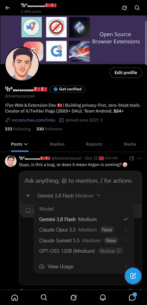
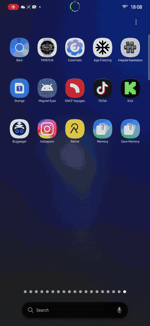

# Save Memory

A tiny Android app with one job: open the **Samsung Memory** app's capture screen
(`ScreenCaptureViewerActivity`) as a **real launcher app**. It shows up in your app
drawer, can be pinned to a sidebar (Edge panel / Good Lock Home Up), and can be bound to
gestures, which a plain shortcut can't do.

It uses Samsung's own Memory icon, pulled from the installed app, with the label **Save Memory**
so you can tell it apart from the main Memory app.

## Compatibility

- Requires **One UI 9** with the Samsung **Memory** app installed (`com.samsung.android.app.memory`).
- Tested on a **Galaxy S24+** on One UI 9, with every feature below working. It should work on the S24 and newer.
- Android 8.0+ (min SDK 26).

## How it works

Tap the icon and the app starts `com.samsung.android.app.memory/.feature.capture.ScreenCaptureViewerActivity`, then closes itself. It has no UI of its own.

[](media/how-it-works.mp4)

*Click the preview for the full-quality video.*

## Install

1. Download [`MemoryLauncher.apk`](MemoryLauncher.apk) (or build it, see below).
2. Install it (`adb install -r MemoryLauncher.apk`, or open the file on the phone).
3. Open **Save Memory** from the app drawer, or add it to your sidebar.

## Three-finger swipe down (Good Lock > Home Up)

Bind Save Memory to a three-finger swipe down on the home screen. Walkthrough:

[](media/three-finger-swipe-setup.mp4)

*Click the preview for the full-quality video.*

Note: one early tester reported the three-finger swipe didn't trigger on their setup; the app itself worked as expected.

## Build from source

No Gradle needed. Requires a JDK and the Android SDK (build-tools 36, platform 35):

```powershell
./build.ps1
```

The script compiles resources with `aapt2`, builds with `javac` and `d8`, then aligns and signs the APK with a locally generated debug key.

## Notes

- Package: `com.incconutwo.savememory`.
- Targets the Samsung Memory app only, and the activity must be exported on your firmware.
- The Memory icon and name belong to Samsung. This project is unofficial and not affiliated with Samsung.
